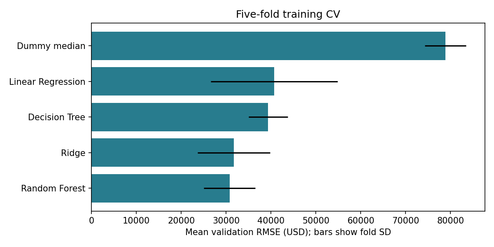
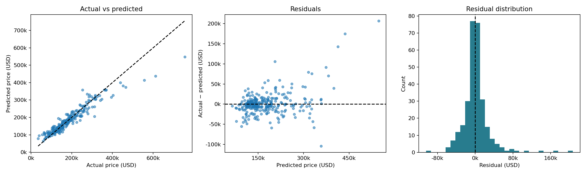

# AmesValue

A regression project for estimating house sale prices from property characteristics.
I used this project to practise comparing models, building preprocessing pipelines,
and understanding where predictions go wrong.

The final model is a Random Forest. On the 292-house test set, its mean absolute
error is **$17,197**, with an RMSE of **$29,206** and an R² of **0.889**.
These results describe historical Ames houses, not current property valuations.

## Data

The bundled CSV contains 1,460 houses and 81 columns from the
[OpenML House Prices dataset (42165)](https://www.openml.org/d/42165).
The target is `SalePrice`, in US dollars. This is the smaller House Prices version
of Ames Housing, rather than the complete 2,930-row dataset.

I treated this as a pre-sale prediction problem. `Id` is excluded, along with
`SaleType`, `SaleCondition`, `MoSold`, and `YrSold`, which describe the eventual
transaction. The remaining 75 inputs are assumed to be available before sale.
`MSSubClass` is a dwelling-type code, so it is treated as categorical.

The data comes from Ames, Iowa, and covers 2006–2010. Original reference:
[Dean De Cock (2011)](https://doi.org/10.1080/10691898.2011.11889627).

## Approach

- Split the data into 1,168 training rows and 292 test rows, using seed 42.
- Explore the training data in `notebooks/01_eda.ipynb`.
- Compare a median baseline, Linear Regression, Ridge, Decision Tree and Random Forest using the same five cross-validation folds.
- Try a log target for the two best initial models, then total bathrooms and total porch area on the best variant.
- Tune the strongest candidate and select by cross-validation RMSE. Models within 1% of the best score are compared using a simplicity rule.
- Fit the selected pipeline on the training data and evaluate it on the test set.

Numeric inputs use median imputation. Linear models also use scaling. Categorical
inputs use a missing-value label and one-hot encoding. These steps are fitted
inside each cross-validation fold, rather than on the full dataset.

## Results

Initial five-fold cross-validation results, rounded to whole dollars:

| Model | MAE | RMSE | R² |
| --- | ---: | ---: | ---: |
| Median baseline | $54,586 | $78,860 | -0.046 |
| Linear Regression | $19,892 | $40,668 | 0.688 |
| Ridge | $18,295 | $31,751 | 0.827 |
| Decision Tree | $25,377 | $39,380 | 0.739 |
| Random Forest | $18,302 | $30,788 | 0.838 |

The selected model uses both engineered features and a raw-price target, with
100 trees, `max_features=0.7` and `min_samples_leaf=2`. Its CV RMSE is **$29,833**.
The RMSE standard deviation across folds is about $5,505.

| Test metric | Value |
| --- | ---: |
| MAE | $17,197.05 |
| RMSE | $29,205.70 |
| R² | 0.8888 |

MAE describes the average absolute error. RMSE gives more weight to large errors,
which is why I used it for selection. R² is not a percentage accuracy score.

Log-transforming the target did not improve Random Forest RMSE. Log Ridge had the
lowest CV MAE, but much larger RMSE and fold variation. Adding the two features
made only a small difference before tuning; the experiments do not isolate their
contribution to the final tuned result.



## What the errors show

The model tends to overpredict cheaper houses and underpredict expensive houses
in the test sample. The highest actual-price quartile has an MAE of about $32,190,
compared with about $9,030 in the second quartile.

Overall quality, living area, garage capacity and basement area have the largest
forest impurity importances. These describe how the model splits the data; they
do not measure the causal effect of a feature on price.



More detail is in [the results discussion](reports/findings.md) and
[the workflow notes](docs/workflow.md).

## Run locally

Use Python 3.12. From the extracted `amesvalue` directory in WSL:

```bash
python3.12 -m venv .venv
source .venv/bin/activate
python -m pip install -r requirements.txt
```

Select this environment as the interpreter in PyCharm. Run commands from the
project root so imports work correctly:

```bash
# Inspect the bundled dataset.
python -m src.data

# Open the EDA notebook and run its cells in order.
python -m notebook notebooks/01_eda.ipynb

# Compare models and save the selected pipeline.
python -m src.train

# Generate test metrics and error reports.
python -m src.evaluate

# Predict from the example CSV, or supply another CSV with the same columns.
python -m src.predict --input data/example_house.csv

python -m pytest -q
```

The saved model can be used without retraining. The example house is a training
row, so its prediction is only a usage example. Custom input must retain all 75
predictor columns with the expected numeric types; missing values can be blank.
Extra columns are ignored. Only load trusted joblib files.

The CSV is included. `python -m src.data --download` fetches it again from OpenML
and requires internet access. Training overwrites the model and training reports;
evaluation overwrites test reports. Rerunning evaluation reproduces the same test,
not a new independent assessment.

## Files

| Path | Purpose |
| --- | --- |
| `src/data.py` | Load, inspect and split the dataset |
| `src/features.py` | Check input columns and build optional features |
| `src/preprocessing.py` | Build the preprocessing and model pipeline |
| `src/train.py` | Compare, tune, select and fit models |
| `src/evaluate.py` | Calculate test metrics, residuals and importance |
| `src/predict.py` | Predict prices from a CSV |
| `notebooks/01_eda.ipynb` | Training-data exploration with saved outputs |
| `models/` | Saved fitted pipeline |
| `reports/` | Scores, predictions, figures and findings |
| `tests/test_prediction.py` | Prediction and preprocessing checks |

## Limitations

The dataset is small, historical and limited to one city. A random split does not
test predictions for a later market or another location. Reusing the same CV folds
for several choices can make the selected CV score optimistic. The test set is
kept out of model selection, although the initial inventory includes full-data
target summaries.

Missing values do not always distinguish an absent facility from unknown
information. The model also struggles with expensive houses and provides no
prediction intervals. Further experiments would need fresh validation; the
existing test results should not become another tuning target.

See [verification notes](reports/verification.md) for the checks performed.
